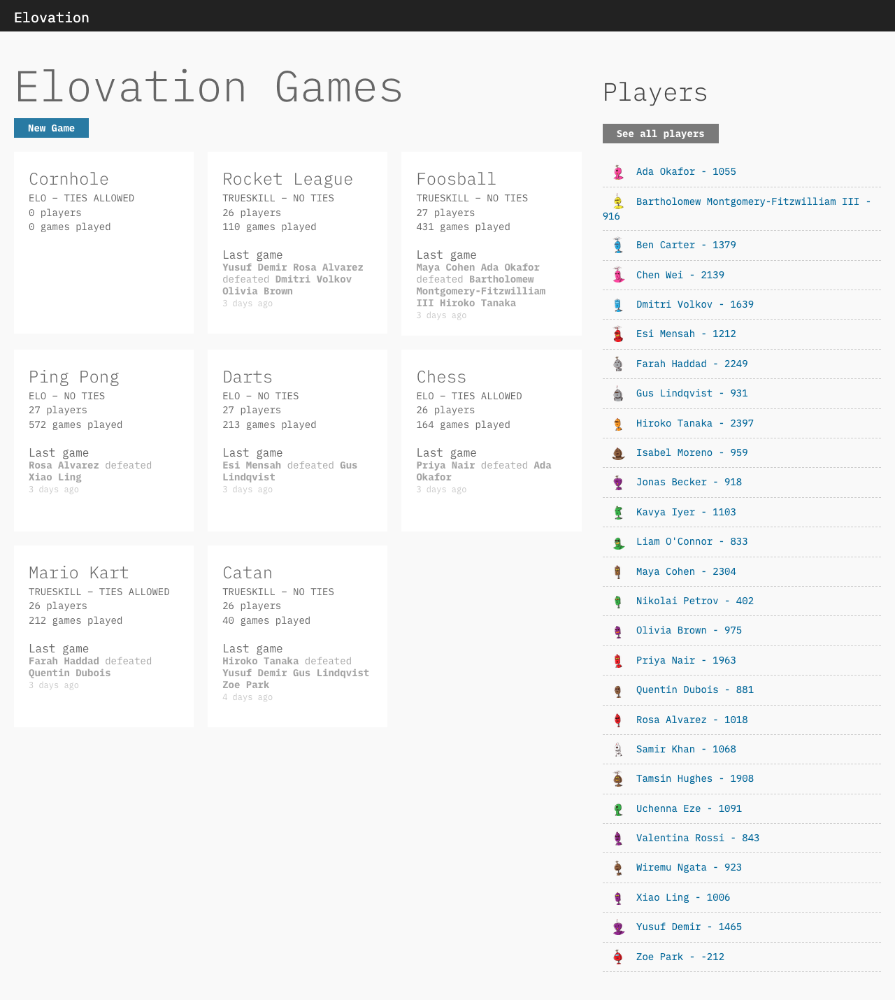
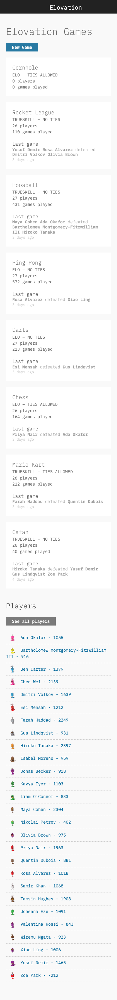
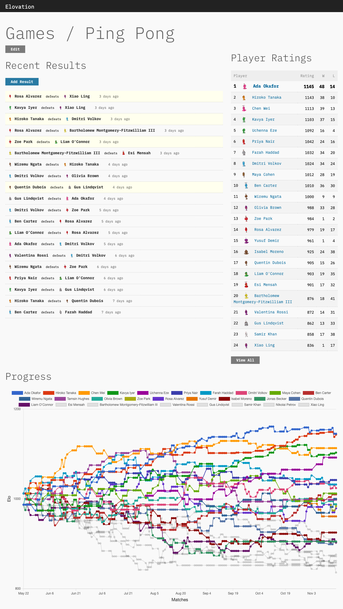
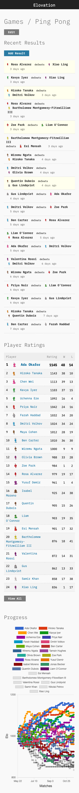
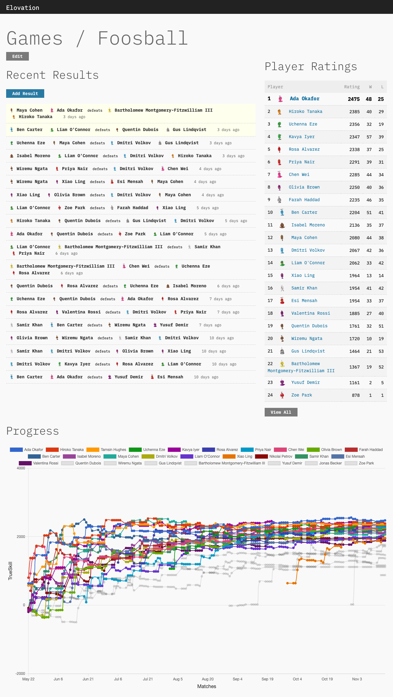
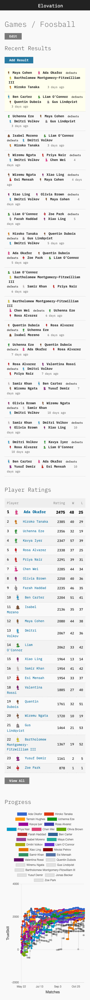
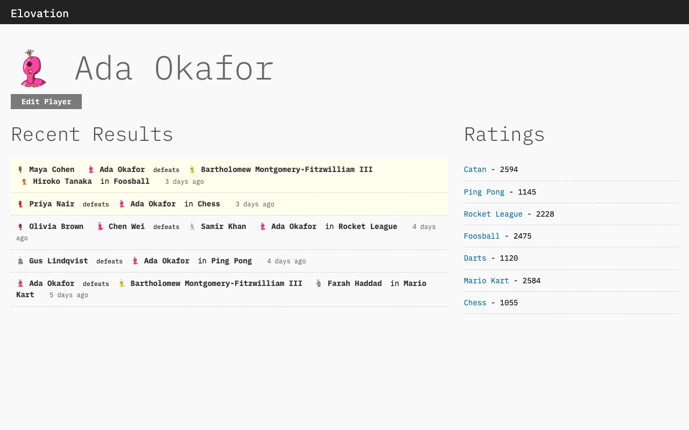
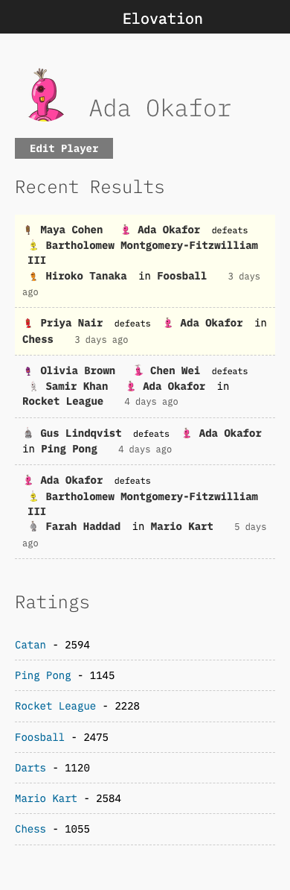

Elovation
===========================

[](https://sonarcloud.io/summary/new_code?id=elovation_elovation)

At Braintree, we play ping pong in the office. We wanted a way to track results and assign ratings to players. Elovation was born. It's a simple rails app that tracks the results of any two player game and assigns ratings to the players using the [Elo rating system](http://en.wikipedia.org/wiki/Elo_rating_system).

This also supports individual player rankings within multi-player teams, using the [Trueskill ranking system](http://research.microsoft.com/en-us/projects/trueskill/)

Screenshots
-----------

<table>
  <tr><th>Desktop</th><th>Mobile</th></tr>
  <tr>
    <td></td>
    <td></td>
  </tr>
  <tr>
    <td></td>
    <td></td>
  </tr>
  <tr>
    <td></td>
    <td></td>
  </tr>
  <tr>
    <td></td>
    <td></td>
  </tr>
</table>

Every page is in [docs/screenshots](docs/screenshots). They show the demo data from `db/seeds.rb`: six months of office play across eight games.

Deploy yourself with Fly.io for free
-------------------------------------
The root of this directory is setup with a Dockerfile ready to deploy to [fly.io](https://fly.io).

To deploy to fly, you must install a command line tool and sign up [using the following instructions](https://fly.io/docs/hands-on/install-flyctl/)

Once you have installed and signed up to fly.io (you can skip the suggested example launcher), you can proceed to generate a fly.toml file for this project to deploy to fly.io

To do this, run `fly launch --dockerfile Dockerfile`, you will be prompted to generate a new project, with a new name. When prompted to setup a postgres database, select yes. You do not need to setup redis, so skip that step.

It should "just work", if it doesn't, please file an issue.

Game Options
------------
There are two types of "Games" that Elovation allows for: [Trueskill](https://en.wikipedia.org/wiki/TrueSkill) & [Elo](https://en.wikipedia.org/wiki/Elo_rating_system)

#### Trueskill
Trueskill allows for teams of multiple players, to play other teams - yet still calculate each individual player's ranking.

When creating a new game you may set the maximum numbers of teams in a result, and the maximum number of players per team in a result. You can record a result in any combination up to the maximum.  

The default is set to 2 players per team, and 2 teams per result (like playing a game of doubles Table Tennis / Foosball). The minimum allowed players per team is 1, and the minimum allowed teams per result is 2.

If you increase the allowed number of teams per result, this will allow scenarios where a team can defeat multiple other teams in a single match at the same time. A possible example of this is a Paint Ball / Nerf War with multiple teams that is "last team standing" - All other teams are the losers and the remaining team is the winner.

Suitable for:
- Table Tennis
- Foosball
- Paint Ball / Nerf Wars

#### Elo
Elo is a simpler method devised for Player versus player games only and does not support teams. It also increments and decrements by a set value which makes a win/loss amount more predictable.

Suitable for:
- Chess
- Table Tennis
- Foosball

#### Trying a different rating system
Ratings are always derived from a game's results, so you can see what any game's leaderboard would look like under another rating system without changing anything:

```bash
bin/rails "ratings:preview[GAME_ID,trueskill]"
```

To recompute every game's ratings from its results, run `bin/rails repair:ratings`.

#### Adding a rating system
Each rating system is a small, self-contained module in `app/models/rating_systems/`. It turns one result's standings into new rating states and never touches the database. The interface is documented in `app/models/rating_systems.rb`. To add one:

1. Create `app/models/rating_systems/<name>.rb` with `key`, `name`, `description`, `supported_format`, `initial_state`, `score(state)` and `rate(standings)`.
2. Register it in `RatingSystems.all`.
3. Add a spec that includes `it_behaves_like "a rating system"` (see `spec/support/rating_system_contract.rb`), plus tests for its own maths.
4. Try it against real games with `ratings:preview`.

No migration is needed: each rating system's state is stored as JSON that only it reads.

Caution
-------
If you intend to use this software commercially, you must remove the Trueskill implementation as it is patented by Microsoft.

TrueSkill is used only by `app/models/rating_systems/true_skill.rb`, which loads the vendored library in `vendor/trueskill`. Removing it means deleting that file, its spec, its entry in `RatingSystems.all`, the `trueskill` line in the `Gemfile` and `vendor/trueskill`. Any existing TrueSkill games would first need a different rating system that supports their format.

Contributing & Development
--------------------------

*Docker*

The root directory of this app contains a `Dockerfile.dev` file, and a `docker-compose.yml` as helpers to make the development experience easier.

Assuming you have Docker installed, you should be able to run `docker compose up` from the root directory, then shell into your web container `docker exec -it elovation-web-1 /bin/bash`, provision your database `rails db:create` and `rails db:migrate RAILS_ENV=development` and get your dev instance running and accessible from `http://localhost:4321`

*ASDF*

The root directory contains a .tool-versions file, this is used by a version management tool called [ASDF](https://asdf-vm.com). If you are running Mac OS, you may find you need to run ASDF to help manage your ruby version if you're trying to run without docker, or you wish to make a custom fly.io deployment.

*OS Support*

This was developed in a MacOS environment, but it uses Docker to help with cross-platform compatibility.

When developing/deploying from Windows, please use the Windows Subsystem for Linux, or run the Dockerfiles through a line-endings conversion tool. See: [#115](https://github.com/elovation/elovation/issues/115)
